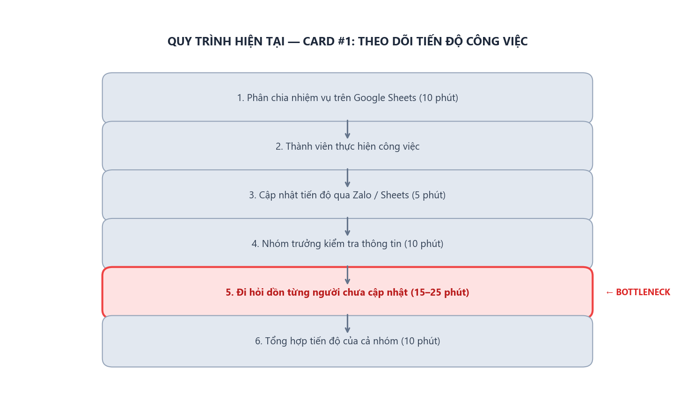

# Báo cáo cá nhân — 2A202603921_DuongMinhChien

## 1. Thông tin học viên

- Họ tên: Dương Minh Chiến
- MSSV: 2A202603921
- Email trường (không bắt buộc, repo có thể để public): 
- Tên nhóm: AURA
- Link repo nhóm: https://github.com/duongchien147/K5-L3B-DAY02-AURA-DiscoveryProblemFraming

---

## 2. Scan problem (CP1)

Bối cảnh: tôi là sinh viên năm 3 ngành Công nghệ thông tin, nhóm trưởng một nhóm đồ án 5 người. Nhóm có 8 tuần để làm một ứng dụng quản lý bán hàng; trao đổi qua Zalo, lưu tài liệu trên Google Drive, giao việc trên Google Sheets và quản lý mã nguồn trên GitHub. Tôi thường gặp khó khăn với ba việc: theo dõi tiến độ, tìm lại thông tin và xếp lịch họp. Cả ba làm phối hợp chậm và có thể ảnh hưởng đến deadline.

Lăng kính: **Lặp lại** · **Tốn thời gian** · **Cần đọc, tổng hợp nhiều thông tin** · **Pain từ người khác**.

| #   | Lăng kính              | Job Story: Khi… tôi muốn… để…                                                                                                                                | Ai chịu ảnh hưởng?                | Dấu hiệu thật (thời gian, tần suất, số người, bằng chứng)               |
| ---:| ---------------------- | ------------------------------------------------------------------------------------------------------------------------------------------------------------ | --------------------------------- | ----------------------------------------------------------------------- |
| 1 | Pain từ người khác | Khi phân chia công việc đồ án, tôi muốn biết rõ nhiệm vụ và khối lượng của từng thành viên để tránh tình trạng người làm quá nhiều, người làm quá ít. | Nhóm trưởng, thành viên | Nhiệm vụ bị dồn cho một số người, thành viên phải làm thay. [CẦN ĐIỀN: bao nhiêu lần, ai làm thay] |
| 2 | Tốn thời gian | Khi cần tổ chức họp nhóm, tôi muốn tìm được thời gian phù hợp với tất cả thành viên để không phải nhắn tin hỏi lịch từng người. | Cả nhóm | Ước tính của tôi (chưa bấm giờ): 10–15 phút mỗi lần tổng hợp lịch, chưa tính thời gian chờ phản hồi. [CẦN ĐIỀN: số lần đổi lịch họp, số tin nhắn của lần họp gần nhất] |
| 3 | Lặp lại | Khi theo dõi tiến độ đồ án, tôi muốn biết nhiệm vụ nào đã hoàn thành và nhiệm vụ nào còn tồn đọng để không phải hỏi từng thành viên mỗi ngày. | Nhóm trưởng, thành viên | Ước tính của tôi (chưa bấm giờ): 15–25 phút mỗi lần kiểm tra nhiều nguồn và hỏi lại từng người. [CẦN ĐIỀN: số lần phải hỏi tiến độ trong một tuần, số nhiệm vụ cập nhật muộn] |
| 4 | Cần tổng hợp thông tin | Khi thông tin nằm rải rác trong Zalo, Google Drive và Google Sheets, tôi muốn tìm lại tài liệu và quyết định của nhóm nhanh chóng để tránh bỏ sót thông tin. | Cả nhóm | Ước tính của tôi (chưa bấm giờ): 5–10 phút mỗi lần tìm lại tài liệu hoặc quyết định. [CẦN ĐIỀN: số lần tìm trong một tuần, số lần phải hỏi lại người gửi] |
| 5 | Pain từ người khác | Khi một thành viên chưa hoàn thành phần việc của mình, tôi muốn biết sớm vì công việc đó ảnh hưởng đến nhiệm vụ của người tiếp theo. | Nhóm trưởng, thành viên phụ thuộc | [CẦN ĐIỀN: số nhiệm vụ bị chậm vì chờ thành viên khác, số lần phải đổi kế hoạch] |
| 6 | Tốn thời gian | Khi các thành viên cùng chỉnh sửa mã nguồn, tôi muốn nhận biết và xử lý những thay đổi xung đột để tránh mất thời gian sửa lỗi khi ghép code. | Các thành viên lập trình | [CẦN ĐIỀN: số lần xảy ra conflict, thời gian xử lý mỗi lần] |
| 7 | Cần tổng hợp thông tin | Khi nhận góp ý từ giảng viên và các thành viên về báo cáo, tôi muốn tổng hợp các góp ý tại một nơi để biết nội dung nào cần chỉnh sửa. | Nhóm trưởng, người viết báo cáo | [CẦN ĐIỀN: số góp ý bị bỏ sót, số lần phải hỏi lại nội dung chỉnh sửa] |
| 8 | Lặp lại | Khi gần đến hạn nộp đồ án, tôi muốn kiểm tra các phần việc, tài liệu và chức năng đã hoàn thành để đảm bảo nhóm không bỏ sót nội dung cần nộp. | Nhóm trưởng, cả nhóm | [CẦN ĐIỀN: số nội dung còn thiếu khi kiểm tra, số lần phải sửa sát deadline] |

**Nếu có dùng AI để gợi ý thêm:** ý nào AI gợi ý mà bạn giữ lại, ý nào bỏ và vì sao.

- Tôi dùng AI để gợi ý thêm các vấn đề sinh viên hay gặp khi làm đồ án nhóm. Tôi giữ lại các ý về xếp lịch họp, theo dõi tiến độ, tìm lại thông tin và conflict khi ghép code trên GitHub, vì chúng phù hợp với bối cảnh làm đồ án của nhóm. Ý bàn giao công việc khi có thành viên nghỉ tôi chỉ cân nhắc, vì không nhóm nào cũng gặp. Tôi bỏ các ý về chi phí tổ chức sự kiện và phối hợp giữa các phòng ban doanh nghiệp vì không liên quan đến sinh viên làm đồ án. Các ý giữ lại vẫn cần kiểm chứng qua phỏng vấn sinh viên.

---

## 3. Top 3 Problem Cards + quy trình nháp (CP2)

### Bảng chọn top 3

| Rank | Problem                                                            | Vì sao chọn                                                             | Điều còn chưa chắc                                            |
| ----:| ------------------------------------------------------------------ | ----------------------------------------------------------------------- | ------------------------------------------------------------- |
| 1    | Khó theo dõi tiến độ công việc của từng thành viên.                | Xảy ra thường xuyên, ảnh hưởng trực tiếp đến deadline và việc phối hợp. | Thành viên có thường xuyên cập nhật tiến độ hay không?        |
| 2    | Thông tin, tài liệu và quyết định bị phân tán trên nhiều nền tảng. | Làm mất thời gian tìm kiếm, dễ bỏ sót thông tin.                        | Mức độ ảnh hưởng và tần suất tìm kiếm lại thông tin.          |
| 3    | Khó sắp xếp lịch họp nhóm.                                         | Các thành viên có lịch học và lịch cá nhân khác nhau.                   | Vấn đề có xảy ra thường xuyên và gây ảnh hưởng đáng kể không? |

### Problem Card #1– Khó theo dõi tiến độ công việc

| Trường                                    | Nội dung                                                                                                                                                                                                                                                                  |
| ----------------------------------------- | ------------------------------------------------------------------------------------------------------------------------------------------------------------------------------------------------------------------------------------------------------------------------- |
| Job Story                                 | Khi thực hiện đồ án nhóm, tôi muốn theo dõi trạng thái và tiến độ công việc của từng thành viên để kịp thời phát hiện nhiệm vụ bị chậm.                                                                                                                                   |
| Actor                                     | Chiến – nhóm trưởng và 4 thành viên.                                                                                                                                                                                                                                      |
| Thời điểm / bối cảnh                      | Trong suốt 8 tuần thực hiện đồ án, đặc biệt trước các deadline.                                                                                                                                                                                                           |
| Quy trình hiện tại (3–7 bước)             | 1. Chiến phân chia nhiệm vụ trên Google Sheets. 2. Thành viên thực hiện công việc. 3. Thành viên cập nhật tiến độ hoặc báo cáo qua Zalo. 4. Chiến kiểm tra bảng phân công và tin nhắn. 5. Chiến hỏi lại những người chưa cập nhật. 6. Chiến tổng hợp tiến độ của cả nhóm. |
| Bottleneck (bước nào, mất bao nhiêu phút) | Bước 4–5: Phải kiểm tra nhiều nguồn và hỏi từng thành viên. Ước tính 15–25 phút/lần kiểm tra, cần khảo sát lại.                                                                                                                                                           |
| Impact (nếu không giải thì sao)           | Phát hiện nhiệm vụ chậm muộn, ảnh hưởng đến công việc của thành viên khác và tiến độ chung.                                                                                                                                                                               |
| Success metric (baseline → target)        | Thời gian tổng hợp tiến độ: 15–25 phút → dưới 10 phút/lần.                                                                                                                                                                                                                |
| Phương án không dùng AI                   | Sử dụng một bảng Kanban hoặc Google Sheets thống nhất, yêu cầu thành viên cập nhật trạng thái và deadline.                                                                                                                                                                |
| Giả thuyết về AI (nếu có)                 | AI có thể tổng hợp cập nhật từ các thành viên và nhận diện nhiệm vụ có nguy cơ trễ hạn.                                                                                                                                                                                   |
| Cảm nhận nhanh                            | Workflow                                                                                                                                                                                                                                                                  |

Quy trình nháp hiện tại:

```text
Phân chia nhiệm vụ trên Google Sheets
              ↓
Thành viên thực hiện công việc
              ↓
Cập nhật tiến độ qua Zalo / Sheets
              ↓
Chiến kiểm tra thông tin
              ↓
Hỏi lại thành viên chưa cập nhật (15–25 phút) ← BOTTLENECK
              ↓
Tổng hợp tiến độ cả nhóm
```



### Problem Card #2 – Thông tin và tài liệu bị phân tán

| Trường                                    | Nội dung                                                                                                                                                                                                                              |
| ----------------------------------------- | ------------------------------------------------------------------------------------------------------------------------------------------------------------------------------------------------------------------------------------- |
| Job Story                                 | Khi cần tìm lại tài liệu hoặc quyết định đã trao đổi, tôi muốn tìm kiếm thông tin nhanh chóng để tiếp tục công việc mà không phải hỏi lại các thành viên.                                                                             |
| Actor                                     | Chiến và 4 thành viên.                                                                                                                                                                                                                |
| Thời điểm / bối cảnh                      | Khi làm báo cáo, chỉnh sửa chức năng hoặc cần xem lại nội dung đã thống nhất.                                                                                                                                                         |
| Quy trình hiện tại (3–7 bước)             | 1. Các thành viên trao đổi trên Zalo. 2. Tài liệu được tải lên Google Drive. 3. Nhiệm vụ được ghi trên Google Sheets. 4. Khi cần thông tin, Chiến tìm lại tin nhắn hoặc tài liệu. 5. Nếu không tìm thấy, Chiến hỏi thành viên đã gửi. |
| Bottleneck (bước nào, mất bao nhiêu phút) | Bước 4–5: Phải tìm ở nhiều nơi hoặc hỏi lại người khác. Thời gian ước tính 5–10 phút/lần tìm, cần kiểm chứng.                                                                                                                         |
| Impact (nếu không giải thì sao)           | Mất thời gian, sử dụng nhầm tài liệu cũ hoặc bỏ sót quyết định đã thống nhất.                                                                                                                                                         |
| Success metric (baseline → target)        | Thời gian tìm tài liệu: 5–10 phút → dưới 2 phút/lần tìm.                                                                                                                                                                              |
| Phương án không dùng AI                   | Thống nhất cấu trúc thư mục Google Drive, quy tắc đặt tên file và lưu các quyết định quan trọng vào một tài liệu chung.                                                                                                               |
| Giả thuyết về AI (nếu có)                 | AI có thể tìm kiếm thông tin theo câu hỏi tự nhiên, tóm tắt nội dung và dẫn đến tài liệu nguồn.                                                                                                                                       |
| Cảm nhận nhanh                            | Workflow (có thể tích hợp AI hỗ trợ tìm kiếm).                                                                                                                                                                                        |

Quy trình nháp hiện tại:

```text
Trao đổi trên Zalo
        ↓
Lưu tài liệu trên Google Drive
        ↓
Ghi nhiệm vụ trên Google Sheets
        ↓
Phát sinh nhu cầu tìm thông tin
        ↓
Tìm lại tin nhắn / tài liệu (5–10 phút/lần, ước tính) ← BOTTLENECK
        ↓
Hỏi thành viên nếu không tìm thấy ← BOTTLENECK
```

### Problem Card #3 – Khó sắp xếp lịch họp nhóm

| Trường                                    | Nội dung                                                                                                                                                                                         |
| ----------------------------------------- | ------------------------------------------------------------------------------------------------------------------------------------------------------------------------------------------------ |
| Job Story                                 | Khi cần tổ chức họp nhóm, tôi muốn tìm được khung giờ phù hợp với các thành viên để tiết kiệm thời gian thống nhất lịch.                                                                         |
| Actor                                     | Chiến và 4 thành viên.                                                                                                                                                                           |
| Thời điểm / bối cảnh                      | Trước các buổi họp định kỳ hoặc khi cần giải quyết vấn đề phát sinh.                                                                                                                             |
| Quy trình hiện tại (3–7 bước)             | 1. Chiến đề xuất thời gian họp trên Zalo. 2. Các thành viên phản hồi lịch rảnh. 3. Chiến tổng hợp câu trả lời. 4. Chiến tìm khung giờ phù hợp. 5. Nếu có người bận, nhóm tiếp tục chọn lại lịch. |
| Bottleneck (bước nào, mất bao nhiêu phút) | Bước 2–4: Phải chờ phản hồi và đối chiếu lịch từng người. Thời gian tổng hợp ước tính 10–15 phút, chưa tính thời gian chờ.                                                                       |
| Impact (nếu không giải thì sao)           | Mất thời gian trao đổi, cuộc họp bị trì hoãn hoặc thiếu thành viên quan trọng.                                                                                                                   |
| Success metric (baseline → target)        | Thời gian thống nhất lịch: 10–15 phút → dưới 5 phút.                                                                                                                                             |
| Phương án không dùng AI                   | Sử dụng Google Calendar hoặc Google Forms để thu thập lịch rảnh và chọn khung giờ phù hợp.                                                                                                       |
| Giả thuyết về AI (nếu có)                 | AI có thể đề xuất thời gian họp dựa trên lịch rảnh của các thành viên nếu được cấp quyền truy cập phù hợp.                                                                                       |
| Cảm nhận nhanh                            | Rule / Workflow                                                                                                                                                                                  |

Quy trình nháp hiện tại:

```text
Chiến đề xuất lịch họp trên Zalo
              ↓
Thành viên phản hồi lịch rảnh ← BOTTLENECK (bước 2–4: 10–15 phút/lần, chưa tính thời gian chờ)
              ↓
Chiến tổng hợp câu trả lời ← BOTTLENECK
              ↓
Đối chiếu thời gian của mọi người ← BOTTLENECK
              ↓
Thống nhất hoặc chọn lại lịch
```

### Card muốn pitch nhất

- Card số: Thông tin và tài liệu bị phân tán.
- Vì sao: Đây là vấn đề có thể xảy ra xuyên suốt quá trình làm đồ án. Thành viên thường phải tìm lại tài liệu, nội dung trao đổi và quyết định cũ. AI có thể hỗ trợ tìm kiếm thông tin bằng ngôn ngữ tự nhiên, nhưng cần so sánh với phương án tổ chức Google Drive thông thường.
- Câu hỏi muốn nhóm phản biện: Liệu vấn đề này thực sự cần AI giải quyết hay chỉ cần thống nhất cách lưu trữ và quản lý tài liệu?

### AI đã phản biện card thế nào

| Điểm yếu AI chỉ ra                      | Đồng ý? | Đã sửa gì                                                      |
| --------------------------------------- | ------- | -------------------------------------------------------------- |
| Vấn đề thông tin phân tán còn khá rộng. | Có      | Thu hẹp vào việc tìm lại tài liệu và quyết định đã thống nhất. |

---

## 4. Tôi đã tham gia phần nào (CP3 → CP7)

| Hoạt động | Tôi đã làm gì? | Kết quả / ảnh hưởng tới bài nhóm |
|---|---|---|
| Pitch Problem Card | Pitch 3 card cá nhân, bảo vệ Card #2 về việc tài liệu và quyết định bị trôi trên Zalo, Google Drive, Sheets | Cả nhóm đồng thuận chọn Card #2 làm candidate chung vì đều từng gặp tình cảnh lục tin nhắn tìm link tài liệu |
| Phản biện bài của bạn khác | Hỏi Trung về MLflow (có quá nặng với đồ án môn học không); hỏi Thịnh về việc tổng hợp báo cáo (chậm do trễ hạn hay do ghép nội dung); hỏi Đức về script check tên file lab (regex hay AI) | Giúp nhóm loại bỏ các ý tưởng thiên về công cụ phức tạp hoặc có thể giải quyết nhanh bằng code thông thường |
| Nhận phản biện | Thịnh hỏi (candidate #2 của tôi): "Bottleneck thật sự là do công cụ tìm kiếm kém, hay do quy ước đặt tên thư mục trên Google Drive của nhóm chưa thống nhất ngay từ đầu?" Đức hỏi (candidate #1 của tôi): "Nếu nhóm chỉ cần quy định 1 bảng Kanban/Trello cố định và cam kết cập nhật hằng ngày lúc 18h thì đã giải quyết được chưa, tại sao vẫn cần AI?" | Với câu của Thịnh, tôi thừa nhận một phần nguyên nhân nằm ở thói quen lưu trữ lộn xộn của nhóm. Nhóm sửa lại: dùng Rule để chuẩn hóa và ghim link, AI chỉ đối chiếu ngữ nghĩa câu hỏi với nội dung tài liệu. Candidate #1 không vào shortlist |
| Gom cluster / cây OST | Điều phối nhóm gom 15 card thành 3 cụm; cùng nhóm dựng cây OST với mục tiêu giảm thời gian tìm kiếm từ 45 phút xuống dưới 5 phút | Phân định rạch ròi giữa mong muốn thực tế (Opportunity) và giải pháp kỹ thuật (Solution), không để giải pháp lấn át vấn đề |
| Chọn candidate problem | Cùng nhóm chấm điểm 3 candidate theo 7 tiêu chí trong bảng shortlist; giải thích lý do chọn Candidate #2 và loại Candidate #10, #13 | Candidate #2 đạt điểm cao nhất (34/35) nhờ phạm vi vừa sức kiểm chứng và mức độ ảnh hưởng trực tiếp tới công việc của nhóm |
| Kiểm chứng / research | Cùng Thịnh đọc số liệu survey 8 người (hỏi về việc tổng hợp báo cáo); cùng Trung rà soát 6 công cụ giải pháp | 6/8 người thường xuyên tham gia tổng hợp báo cáo, 5/8 thấy thu thập báo cáo từ nhiều nguồn là khó nhất. Survey chưa hỏi việc tìm lại tài liệu nên chưa xác nhận trực tiếp pain của candidate #2. Qua research, các công cụ tìm kiếm xuyên kênh đang nhắm tới doanh nghiệp, chưa có loại nhẹ cho nhóm sinh viên |
| Quy trình nhóm | Cùng Đức rà soát 7 bước hiện tại, chỉ ra bước 6 (ngồi chờ người gửi link trả lời) là nút thắt gây tốn 15 phút; dựng quy trình mới 3 bước | Xác định rõ vai trò con người: AI tìm trích dẫn, người bấm link kiểm tra lại nguồn trước khi chép vào bài làm |
| Problem Statement | Viết Problem Statement v0 đủ 6 trường (mục 5). Bản v1 (mục 7) do Trường điền; tôi hỗ trợ theo phân công trong `TEAM.md` | Sau góp ý của AI và nhóm, v0 bỏ giải pháp ra khỏi câu chữ, có số đo cụ thể và ranh giới rõ |
| Mức can thiệp AI | Cùng Trường phân tích ma trận Ambiguity x Complexity; thảo luận 4 mức can thiệp để chọn ra mức phù hợp | Bác bỏ ý tưởng dựng Autonomous Agent; chốt mức Workflow (kết hợp Rule + AI một bước + con người duyệt) |
| Quyết định | Tham gia đánh giá 4 rủi ro (Value, Usability, Feasibility, Viability); đề xuất phương án Go với pilot nhỏ 2 tuần | Mốc dừng trong báo cáo nhóm: sau 2 tuần, nếu thời gian tìm tài liệu vẫn trên 15 phút/lần hoặc hơn 50% câu hỏi AI không tìm được nguồn thì quay về cách cũ |

---

## 5. Dùng AI

| Checkpoint | Tôi dùng AI để làm gì? | AI hữu ích ở đâu? | AI sai hoặc hời hợt ở đâu? | Tôi sửa gì bằng nhận định của mình? |
|---|---|---|---|---|
| CP1 Scan | Tìm ý tưởng về các điểm nghẽn thời gian trong học tập qua 4 lăng kính | Nhắc lại các tình huống hay quên hạn nộp hoặc lẫn lộn phiên bản slide | Gợi ý chung chung như "quản lý thời gian chưa tốt", không có ngữ cảnh cụ thể | Tự viết 8 vấn đề dựa trên chính trải nghiệm làm bài tập lớn các kỳ trước |
| CP2 Problem Card | Rà soát cấu trúc Problem Card xem có bị lẫn lộn giữa vấn đề và giải pháp không | Chỉ ra Card #2 lúc đầu viết ôm đồm cả việc phân chia công việc lẫn lưu trữ | Đề xuất tích hợp mô hình ngôn ngữ vào đủ thứ công cụ (Notion, Trello, Google Drive) | Thu gọn card vào đúng việc tìm lại tài liệu và quyết định họp bị trôi |
| CP4 Research | Tra cứu các phần mềm tìm kiếm nội bộ doanh nghiệp có sẵn | Cung cấp tên các giải pháp như Glean, Conclude, Slite | Mô tả các phần mềm như thể sinh viên có thể dùng ngay, bỏ qua chi phí đắt đỏ | Hướng nhóm kiểm tra các công cụ miễn phí gần gũi hơn như Google Drive Search, Gemini NotebookLM |
| CP5 Quy trình | Kiểm tra sơ đồ quy trình làm việc xem có thiếu bước xử lý lỗi nào không | Nhắc bổ sung phương án quay về cách thủ công khi hệ thống gặp sự cố | Đòi nhét thêm bước AI tự gắn nhãn tài liệu làm tăng nguy cơ phân loại sai | Giữ quy tắc con người tự đặt tên folder theo quy ước, AI chỉ đọc nội dung tìm kiếm |
| CP5–6 Problem Statement | Nhờ AI chấm điểm câu Problem Statement v0 theo bộ 5 tiêu chí chuẩn | Phát hiện ra nhóm đang cài từ khóa giải pháp vào v0 thay vì nói về nỗi đau | Viết lại câu văn nghe bóng bẩy, sáo rỗng và thiếu hẳn số liệu thực tế | Tự viết lại v0 với thời gian đo đếm cụ thể (45 phút xuống dưới 5 phút) và ranh giới rõ |
| CP6 Mức can thiệp / quyết định | So sánh ưu nhược điểm giữa phương án Workflow và Autonomous Agent | Liệt kê các nguy cơ của Agent: chi phí gọi API cao, vòng lặp vô tận, ảo giác | Có xu hướng thiên vị Agent vì nghe tân tiến và hấp dẫn hơn về mặt công nghệ | Chọn mức Workflow vì bài toán sinh viên cần sự chính xác có trích dẫn nguồn gốc hơn là tự động hóa mù quáng |

---

## 6. Reflection (CP7)

Trả lời bằng trải nghiệm thật của bạn, tối thiểu 200 từ cho các câu 6.1–6.6 (không tính 6.7, câu này được chấm riêng ở tiêu chí C5). **Không dùng AI để viết thay.**

**6.1. Tôi học được gì khi nghe top 3 problems của các bạn khác?**

Điều tôi để ý nhất là ai trong nhóm cũng xuất phát từ một chuyện bực mình có thật. Trung phải đối chiếu kết quả sau nhiều lần huấn luyện mô hình và mất khoảng 2 tiếng để đọc một bài báo khoa học. Thịnh mỗi cuối tuần phải gom báo cáo từ chat và email vào một file chung. Trường mất 20–30 phút mỗi sáng để lướt tin AI trên X, và muốn hypertune model mà không phải chạy lại nhiều lần.

Nghe xong, tôi thấy nếu không có bước chia sẻ này thì mỗi người chỉ nhìn được góc hẹp của mình. Có vấn đề nghe rất ngầu về kỹ thuật, như hypertune model của Trường, nhưng khi bàn kỹ thì chỉ vài bạn thật sự hiểu và gặp. Còn chuyện tài liệu và quyết định bị trôi trong tin nhắn Zalo thì tôi thấy cả nhóm đều từng gặp. Từ đó tôi rút ra: một bài toán đáng giải cho nhóm là bài toán chạm vào chuyện bực mình chung của mọi người, độ phức tạp kỹ thuật thì chưa chắc.

**6.2. Nhóm có lúc nào bị "solution-first" (nghĩ giải pháp trước khi hiểu vấn đề) không? Lúc đó nhóm nhận ra và xử lý thế nào?**

Nhóm tôi bị dính bẫy nghĩ giải pháp trước ngay từ buổi họp đầu tiên. Vừa thống nhất chủ đề tài liệu phân tán, phản xạ đầu tiên của mấy anh em là bàn xem dùng thư viện nào, cắm API nào, hay làm một con bot Zalo đọc tin nhắn rồi lưu vào cơ sở dữ liệu vector. Ai cũng hào hứng nói về công nghệ và quên hỏi sinh viên đang tìm tài liệu bằng cách nào, mất thời gian nhất ở bước nào.

Khi mở lại tài liệu lab và đến phần cây OST, nhóm mới khựng lại, vì cây OST bắt phải viết Outcome và Opportunity trước Solution. Tôi bảo cả nhóm dừng bàn về code và bot. Nhóm ngồi liệt kê quy trình thực tế: mở Zalo, lướt tin nhắn, gõ từ khóa; không thấy thì mở Drive; vẫn không ra thì nhắn hỏi người gửi. Nhìn lại quy trình đó, nhóm thấy nút thắt nằm ở việc chờ người gửi trả lời, không phải ở chỗ thiếu một con AI biết trò chuyện. Cây OST cuối cùng gạch bỏ ý "chatbot AI tra cứu tài liệu trên Zalo".

**6.3. Tôi có đổi ý sau khi bị phản biện không? Kể một lần cụ thể.**

Tôi đổi ý ở chỗ xác định nguyên nhân gốc. Khi pitch Card #2, tôi cho rằng lỗi chính là tìm kiếm của Zalo và Drive quá kém, nên cần một công cụ quét toàn bộ tin nhắn và tài liệu để thay thanh tìm kiếm.

Thịnh hỏi: "Bottleneck thật sự là do công cụ tìm kiếm kém, hay do quy ước đặt tên thư mục trên Google Drive của nhóm chưa thống nhất ngay từ đầu?" Câu này trúng điểm yếu của tôi. Nếu có bạn gửi file tên file_moi_1.docx rồi vứt vào tin nhắn thì công cụ nào cũng khó tìm, và tôi đang kỳ vọng AI dọn đống lộn xộn do con người tạo ra. Sau buổi đó tôi đồng ý đổi hướng: nhóm cần quy ước đặt tên và một bảng Sheets tập trung (Rule) trước, AI chỉ đối chiếu câu hỏi tự nhiên với nội dung bên trong tài liệu.

**6.4. Kết quả kiểm chứng (phỏng vấn/survey/research) có làm tôi bất ngờ không? Điều gì?**

Điều làm tôi bất ngờ là kết quả khảo sát không trả lời đúng câu hỏi của nhóm. Survey có 8 người và hỏi về việc tổng hợp báo cáo, không hỏi về việc tìm lại tài liệu và quyết định, tức là không phải vấn đề nhóm đã chọn. Đức đã ghi giới hạn này ở mục 3.2 của báo cáo nhóm.

Về nội dung, 6/8 người thường xuyên tham gia tổng hợp báo cáo và 5/8 nói khó nhất là thu thập báo cáo từ nhiều nguồn. Con số này gần với pain của nhóm nhưng chưa chứng minh được nó. Phía phản bác có 2/8 người nói tổng hợp thủ công không ảnh hưởng hoặc ảnh hưởng ít, và 3/8 người gặp khó ở định dạng hoặc độ chính xác chứ không ở khâu thu thập. Vì vậy báo cáo nhóm xếp rủi ro Value ở mức Trung bình và để pilot 2 tuần đo lại baseline.

**6.5. Điều khó nhất khi viết Problem Statement là gì?**

Khó nhất là không đưa giải pháp vào câu chữ và tìm được con số để nói nỗi đau lớn cỡ nào. Khi viết v0, tay tôi cứ quen gõ "xây dựng trợ lý AI", "tự động hóa tìm kiếm", "giúp sinh viên tra cứu nhanh". Phải đến khi AI và các bạn soi từng chữ, tôi mới thấy mình đang tả sản phẩm muốn làm chứ không tả vấn đề người dùng đang chịu.

Con số cũng là chỗ nhóm còn yếu. Baseline 45 phút mỗi lần tìm trong báo cáo nhóm là ước tính từ một lần tìm gần nhất của Đức, chưa ai bấm giờ. Baseline trong card CP2 của tôi là 5–10 phút mỗi lần, và hai con số này chưa được đối chiếu với nhau, nên pilot phải đo lại. Ranh giới (Boundary) cũng khó: nhóm phải viết thẳng rằng AI chỉ đọc, không sửa, xóa hay gửi tài liệu, không tự chốt quyết định và không trả lời khi không có nguồn, thay vì hứa một hệ thống làm được nhiều việc.

**6.6. Nếu làm lại, tôi sẽ đổi gì? Tôi sẽ phản biện nhóm mạnh hơn ở điểm nào?**

Nếu làm lại, tôi sẽ làm khảo sát và phỏng vấn người dùng sớm hơn, ngay từ CP2 thay vì đợi đến CP4. Có số thật sớm thì nhóm đỡ tranh cãi bằng cảm tính khi chấm shortlist.

Về phản biện, tôi sẽ phản biện mạnh hơn ý tưởng Agent tự hành ngay từ đầu. Trong nhóm vẫn có bạn tiếc công nghệ cao và muốn đưa LLM vào làm mọi khâu. Lẽ ra tôi nên hỏi thẳng về chi phí vận hành, nguy cơ mô hình bịa thông tin trong bài tập môn học, và ai chịu trách nhiệm nếu câu trả lời sai làm nộp bài thiếu nội dung. Chốt sớm mức Workflow có con người kiểm tra thì nhóm đã đỡ tốn thời gian tranh luận.

**6.7. Hiểu bài:** giải thích bằng 5–8 câu, không nhìn tài liệu, chuỗi *problem → quy trình → metric → boundary → mức can thiệp AI → quyết định* của bài nhóm mình.

Sinh viên làm đồ án nhóm mất khoảng 45 phút mỗi lần tìm lại một tài liệu hoặc quyết định (ước tính, chưa đo) vì thông tin nằm rải rác trên Zalo, Google Drive và Sheets. Quy trình hiện tại gồm 7 bước thủ công, nút thắt là bước chờ người đã gửi trả lời, khoảng 15 phút. Mục tiêu là giảm thời gian tìm xuống dưới 5 phút mỗi lần và không dùng nhầm bản cũ, đo bằng việc thành viên tự ghi giờ trong 2 tuần. Ranh giới: AI chỉ đọc những tài liệu nhóm đã đưa vào, không sửa, xóa hay gửi, không tự chốt quyết định và không trả lời khi không có nguồn; người hỏi phải mở nguồn kiểm tra trước khi dùng. Mức can thiệp là Workflow: Rule gom link về bảng chung, AI tìm và trả lời kèm nguồn, con người kiểm tra. Quyết định là Go ở mức pilot nhỏ 2 tuần với nhóm AURA. Nếu sau 2 tuần thời gian tìm vẫn trên 15 phút mỗi lần, hoặc hơn 50% câu hỏi AI không tìm được nguồn, nhóm quay về cách cũ.


---

## 7. Tài liệu tham khảo

- Báo cáo nhóm AURA: `report/team/group_report.md`
- Ảnh kết quả khảo sát Google Sheets (8 phản hồi): `report/assets/cp4-survey-result.png`
- Biên bản phỏng vấn sâu cá nhân: `report/assets/cp4-interview-snapshot-1.md`
- Sơ đồ quy trình tương lai có điểm kiểm soát: `report/assets/cp5-workflow-future.png`
- Sơ đồ quy trình hiện tại Card 1: `report/assets/cp2-workflow-card-1.png`
- Tài liệu hướng dẫn bài lab: `docs/01-worksheet.md`, `docs/03-international-frameworks.md`
