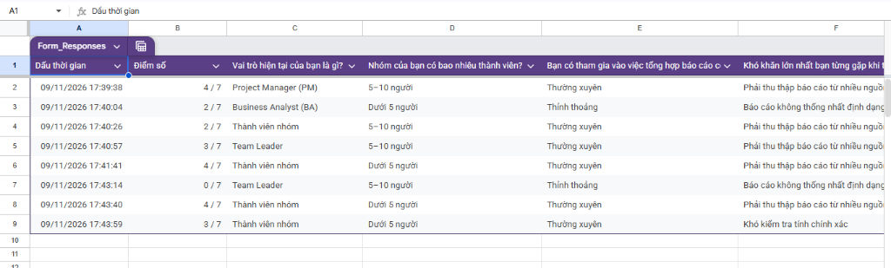
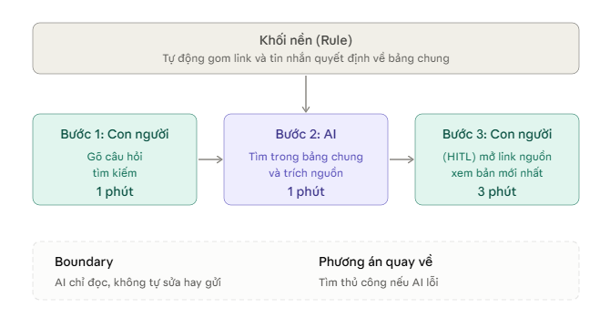

# Báo cáo nhóm — Day 02 Discovery & Problem Framing

> Bản chung của nhóm, viết trên repo do nhóm trưởng fork. Không copy file này sang repo cá nhân.
> Template chi tiết và prompt mẫu: [docs/01-worksheet.md](../../docs/01-worksheet.md). Bài mẫu: [docs/02-deliverable-example.md](../../docs/02-deliverable-example.md).

## 1. Thông tin nhóm

- Tên nhóm: AURA
- Thành viên: xem `TEAM.md`
- Candidate problem được chọn (1 câu): Khi thực hiện đồ án nhóm, các thành viên gặp khó khăn và mất nhiều thời gian khi tìm lại tài liệu, quyết định và thông tin quan trọng bị phân tán trên nhiều kênh (Zalo, Google Drive, Google Sheets).
- Quyết định cuối: Go

---

## 2. Hội tụ nhóm (CP3)

### 2.1. Pitch

| # | Người đưa ra | Candidate (Job Story ngắn) | Actor | Bottleneck | Câu hỏi phản biện nhận được (ai hỏi) |
|---:|---|---|---|---|---|
| 1 | Dương Minh Chiến | Khi thực hiện đồ án nhóm, tôi muốn theo dõi tiến độ công việc của từng người, để kịp thời phát hiện task trễ hạn | Chiến (Lead) và 4 thành viên đồ án | Kiểm tra nhiều kênh (Zalo, Sheets) và phải đi hỏi từng người (15–25'/lần) | "Nếu nhóm chỉ cần quy định 1 bảng Kanban/Trello cố định và cam kết cập nhật hằng ngày lúc 18h thì đã giải quyết được chưa, tại sao vẫn cần AI?" *(Chí Đức hỏi)* |
| 2 | Dương Minh Chiến | Khi cần tìm lại tài liệu hoặc quyết định đã trao đổi, tôi muốn tìm nhanh chóng, để tiếp tục công việc mà không phải hỏi lại | Cả nhóm đồ án (5 người) | Tìm lại tin nhắn trên Zalo, Drive và hỏi người gửi nếu không thấy (5–10'/lần) | "Bottleneck thật sự là do công cụ tìm kiếm kém, hay do quy ước đặt tên thư mục trên Google Drive của nhóm chưa thống nhất ngay từ đầu?" *(Hưng Thịnh hỏi)* |
| 3 | Dương Minh Chiến | Khi cần tổ chức họp nhóm, tôi muốn tìm được khung giờ phù hợp với các thành viên, để tiết kiệm thời gian thống nhất lịch | Cả nhóm đồ án (5 người) | Chờ phản hồi và đối chiếu lịch bận của từng người qua tin nhắn (10–15'/lần) | "Dùng Google Calendar chia sẻ lịch rảnh hoặc Google Form chọn khung giờ thì có giải quyết được không, có cần dùng AI không?" *(Văn Trường hỏi)* |
| 4 | Trần Đức Trung | Khi đọc bài báo khoa học tiếng Anh, tôi muốn nhanh chóng xác định bài toán và kết quả chính, để chọn tài liệu phù hợp | Sinh viên làm NCKH / đồ án | Đọc và phân tích toàn văn bài báo để lọc ý (khoảng 2 tiếng/bài) | "Đọc Abstract và Conclusion thường chỉ mất 5–10 phút để biết bài toán có hợp không, tại sao lại mất tới 2 tiếng nếu chỉ ở bước sàng lọc tài liệu?" *(Văn Trường hỏi)* |
| 5 | Trần Đức Trung | Khi nhóm chuẩn bị nộp bài tập lớn, tôi muốn kiểm tra báo cáo đã đủ yêu cầu của giảng viên, để tránh thiếu sót hoặc sai định dạng | Người rà soát báo cáo nhóm | Đối chiếu từng mục trong báo cáo với rubric và rubric dài (30'/lần) | "Nếu dùng một checklist mẫu in sẵn đối chiếu chéo giữa 2 thành viên trước hạn nộp thì mất bao nhiêu phút, đã thử cách này chưa?" *(Hưng Thịnh hỏi)* |
| 6 | Trần Đức Trung | Khi đánh giá mô hình AI sau nhiều lần train, tôi muốn đối chiếu các chỉ số và cấu hình thí nghiệm, để biết phiên bản nào thực sự cải thiện | Sinh viên / nhóm nghiên cứu AI | Thu thập log/CSV từ nhiều thư mục để ghép vào một bảng đối chiếu (20'/lần) | "Các công cụ tracking có sẵn như MLflow, WandB hoặc TensorBoard đã có sẵn bảng đối chiếu run, tại sao không dùng mà phải tự làm?" *(Minh Chiến hỏi)* |
| 7 | Trịnh Hưng Thịnh | Khi có thành viên mới vào team, tôi muốn có quy trình cụ thể để đào tạo, để họ không mất thời gian hỏi lại quy trình cơ bản | Thành viên mới, người hướng dẫn | Thành viên mới tự mò tài liệu và hỏi lại thành viên cũ nhiều lần (mất 1–2 ngày) | "Tần suất có thành viên mới vào team là bao lâu một lần? Nếu một học kỳ chỉ có 1–2 lần thì impact có đủ lớn để giải quyết bằng công nghệ không?" *(Đức Trung hỏi)* |
| 8 | Trịnh Hưng Thịnh | Khi đến cuối tuần, tôi muốn tự động tổng hợp báo cáo của cả team, để tiết kiệm thời gian gửi lên Lead | PM / Leader | Đọc và tổng hợp nội dung báo cáo từ nhiều tin nhắn chat/email vào 1 file (15–20'/tuần) | "Việc tổng hợp mất 20 phút mỗi tuần là do đọc và tóm tắt chậm, hay do các thành viên nộp báo cáo muộn và thiếu format chuẩn?" *(Minh Chiến hỏi)* |
| 9 | Trịnh Hưng Thịnh | Khi có nhiều ticket gửi đến cùng lúc, tôi muốn biết ticket nào ưu tiên cao hơn, để hoàn thành kịp tiến độ sản xuất | Thành viên xử lý ticket, PM | Phải đọc từng ticket và đánh giá mức độ khẩn cấp thủ công (10–15'/lần) | "Tiêu chí ưu tiên ticket có thể viết thành rule cứng (như deadline + severity) được không, hay bắt buộc phải có AI phán đoán?" *(Chí Đức hỏi)* |
| 10 | Vũ Văn Trường | Khi hypertune model để đạt kết quả tốt, tôi muốn giảm số lần chỉnh thủ công và train/test, để tiết kiệm thời gian và tài nguyên GPU | Kỹ sư AI / Sinh viên làm CV | Chờ mỗi lần train/test 4–5 tiếng, phải lặp lại 5–6 lần (tốn ~1 tuần/model, đốt quota GPU) | "Các framework như Optuna/Ray Tune đã hỗ trợ tự động tìm kiếm và pruning rất tốt, AI (LLM) tham gia vào sinh search space có nguy cơ hallucinate ra hyperparameter không hợp lệ không?" *(Đức Trung hỏi)* |
| 11 | Vũ Văn Trường | Khi mở điện thoại buổi sáng thấy nhiều tin AI trên X, tôi muốn tổng hợp nhanh thay đổi quan trọng, để tiết kiệm thời gian đọc lướt | Người theo dõi tin AI | Phải lướt và đọc thủ công hàng chục bài post trên feed (20–30'/ngày) | "Ai ngoài bạn chịu ảnh hưởng trực tiếp từ việc này? Nếu không đọc news mỗi sáng thì có gây hậu quả đo đạc được (impact) ngay không?" *(Chí Đức hỏi)* |
| 12 | Vũ Văn Trường | Khi đến cuối tháng, tôi muốn tổng hợp và phân loại chi tiêu từ app ngân hàng thành 4 nhóm, để biết tiền đi đâu và phát hiện khoản bất thường | Sinh viên quản lý chi tiêu (cá nhân) | Mở app ngân hàng, tải giao dịch và phân loại thủ công vào 4 nhóm (~3 giờ/tháng) | "Các app ngân hàng hoặc app quản lý chi tiêu như Money Lover đã có biểu đồ tự động phân loại danh mục chi tiêu, sao không dùng giải pháp đó?" *(Minh Chiến hỏi)* |
| 13 | Lưu Nguyễn Chí Đức | Khi vừa làm xong lab và sắp tới hạn nộp, tôi muốn biết chính xác phải nộp file gì và đặt tên thế nào, để không mất điểm vì sai quy trình | Học viên làm lab (AI20K) | Đưa file vào đúng thư mục và tự kiểm tra đối chiếu lại từng file sát giờ nộp (15'/lần nộp) | "Khâu nộp bài chỉ diễn ra sát hạn nộp mỗi tuần 1 lần, một script bash/powershell kiểm tra tên file và thư mục có thể giải quyết 100% không, có cần đến AI không?" *(Minh Chiến hỏi)* |
| 14 | Lưu Nguyễn Chí Đức | Khi nhóm làm nhiều task song song và có task phụ thuộc nhau, tôi muốn biết task nào đã xong để bắt đầu phần tiếp theo, tránh phải nhắn hỏi mỗi ngày | Thành viên nhóm dự án (4 người) | Chờ người trước phản hồi và giải thích bàn giao (mất 40+ phút/lần, có khi chờ cả ngày) | "Nếu nhóm quy định rõ definition-of-done và gửi pull request/commit tag lên GitHub để tự thông báo thì đã giải quyết được việc chờ chưa?" *(Hưng Thịnh hỏi)* |
| 15 | Lưu Nguyễn Chí Đức | Khi tìm việc trên nhiều trang tuyển dụng, tôi muốn biết nhanh tin nào hợp CV, để dành thời gian ứng tuyển vào đúng việc | Sinh viên tìm việc làm | Dò tin trên 5–7 trang (20–60'/lần) và đọc chi tiết từng JD để đối chiếu với CV (35'/tin) | "Bước nghẽn thật sự là do bạn phải vào 5–7 website dò tin thủ công, hay do việc đọc chi tiết từng JD để đối chiếu với CV?" *(Văn Trường hỏi)* |

### 2.2. Cluster

| Cluster | Các candidate | Pattern chung |
|---|---|---|
| A (Quản lý thông tin & Phối hợp nhóm đồ án) | #1, #2, #3, #7, #8, #9, #14 | Thông tin, tiến độ, báo cáo và tài liệu bị phân tán trên nhiều kênh rời rạc (Zalo, Drive, Sheets), phụ thuộc giao tiếp thủ công làm mất thời gian tìm kiếm và theo dõi. |
| B (Hỗ trợ học tập, nghiên cứu & Nộp bài) | #4, #5, #13, #15 | Tốn nhiều thời gian đọc lướt, tổng hợp và đối chiếu tài liệu dài (paper, rubric đồ án, quy định nộp bài lab, JD tuyển dụng) với các tiêu chí/yêu cầu đặt ra. |
| C (Tối ưu hóa quy trình kỹ thuật AI / Vận hành) | #6, #10, #11, #12 | Các tác vụ kỹ thuật lặp lại cần xử lý nhiều dữ liệu hoặc tiêu tốn tài nguyên tính toán (hypertune model, phân loại chi tiêu, theo dõi log thí nghiệm, tổng hợp news). |

### 2.3. Opportunity Solution Tree rút gọn

Gốc là **1 outcome**. Nhánh là **opportunity** (nhu cầu, pain), không phải tính năng hay công cụ.

```text
OUTCOME: Giảm thời gian lãng phí vào các tác vụ tìm kiếm, xác nhận thông tin và phối hợp trong nhóm làm đồ án từ khoảng 45 phút/lần (ước tính) xuống dưới 5 phút/lần
├── Opportunity A: Thông tin, quyết định quan trọng và tài liệu bị trôi và phân tán rải rác trên nhiều kênh chat và nơi lưu trữ
├── Opportunity B: Mất thời gian hỏi từng thành viên để cập nhật tiến độ công việc và trạng thái task
└── Opportunity C: Khó đối chiếu và phát hiện các task phụ thuộc nhau bị tắc nghẽn trước hạn nộp
```

Những ý đã gạch bỏ vì là solution đội lốt opportunity:

- ✗ *"Xây dựng Chatbot AI tra cứu tài liệu trên Zalo"* (Đây là solution cụ thể, đưa giải pháp công nghệ vào trước khi hiểu sâu vấn đề)
- ✗ *"Tạo Dashboard Notion/Trello tự động đồng bộ"* (Đây là công cụ/tính năng, không phải nhu cầu hay pain gốc của người dùng)
- ✗ *"AI Agent tự động nhắc việc và tag tên thành viên"* (Đây là ý tưởng giải pháp đội lốt opportunity)

### 2.4. Chấm điểm shortlist (1–5)

| Candidate | Actor rõ | Quy trình rõ | Pain có bằng chứng | Impact đo được | Vừa sức lab | So sánh được No AI/Rule/Workflow/Agent | Nhóm hiểu domain | Tổng |
|---|---:|---:|---:|---:|---:|---:|---:|---:|
| #2 Thông tin & tài liệu bị phân tán trên nhiều kênh (Chiến) | 5 | 5 | 5 | 4 | 5 | 5 | 5 | **34** |
| #13 Kiểm tra file và cấu trúc trước khi nộp bài lab (Đức) | 5 | 5 | 4 | 4 | 5 | 3 | 5 | **31** |
| #10 Tự động hóa hypertuning mô hình AI (Trường) | 4 | 4 | 4 | 4 | 3 | 4 | 4 | **27** |

**Candidate được chọn:**
Candidate #2 — Khó tìm lại tài liệu, quyết định và nội dung trao đổi bị phân tán trên nhiều nền tảng (Zalo, Google Drive, Google Sheets) trong nhóm đồ án.

**Vì sao chọn:**
1. **Pain có thật và thường trực:** Xảy ra hàng tuần trong suốt 8 tuần làm đồ án của sinh viên; cả 5 thành viên nhóm đều là actor trực tiếp, dễ dàng lấy dữ liệu chứng minh.
2. **Vừa sức và khả thi cao trong lab:** Nhóm có thể phỏng vấn ngay các nhóm sinh viên khác trong lớp tại CP4 để kiểm chứng giả định mà không phụ thuộc hạ tầng phức tạp.
3. **Phổ so sánh 4 mức rất rõ ràng:**
   - *No AI:* Thống nhất quy ước đặt tên file, cấu trúc thư mục Drive và ghim tin nhắn (pin note).
   - *Rule:* Webhook tự động gom link tài liệu gửi vào Zalo về một Google Sheets.
   - *Workflow:* RAG search tra cứu tài liệu ngữ nghĩa.
   - *Agent:* Tự động tổng hợp và trả lời câu hỏi phức tạp xuyên kênh.

**Vì sao loại các candidate còn lại:**
- **Loại Candidate #13 (Kiểm tra file nộp lab):** Mức can thiệp đơn giản nhất là *Rule* (script PowerShell/Bash kiểm tra tên file và thư mục) đã có thể giải quyết triệt để 90–100%. Nếu dùng AI sẽ là over-engineering; hơn nữa phần có thể cải thiện chủ yếu là bước kiểm tra file, khoảng 15 phút mỗi lần nộp.
- **Loại Candidate #10 (Hypertuning model AI):** Đòi hỏi tài nguyên tính toán GPU lớn, thời gian train kéo dài nhiều giờ khiến việc kiểm chứng và đo đạc trong khuôn khổ buổi lab không khả thi; rủi ro ảo giác (hallucination) tham số lớn.

**Xử lý bất đồng (nếu có):**
Ban đầu có thành viên muốn chọn Candidate #10 vì hứng thú với khía cạnh kỹ thuật mô hình AI. Tuy nhiên, sau khi đối chiếu với tiêu chí "Vừa sức trong 4 tiếng lab" và "Khả năng kiểm chứng thực tế với người dùng thật", nhóm đã phản biện rằng Candidate #10 khó phỏng vấn được đối tượng rộng trong lớp và dễ rơi vào bẫy "nghĩ giải pháp trước khi hiểu vấn đề". Cả nhóm đã đồng thuận 100% chọn Candidate #2.

---

## 3. Kiểm chứng + research giải pháp đã có (CP4)

### 3.1. Assumption Map

| # | Giả định | Loại (Value / Usability / Feasibility / Viability) | Quan trọng (1–5) | Đã có bằng chứng (1–5) | Kiểm chứng trước? |
|---:|---|---|---:|---:|---|
| 1 | PM, Team Leader hoặc thành viên nhóm thường xuyên phải tham gia tổng hợp báo cáo công việc. | Value | 5 | 3 | Có |
| 2 | Việc thu thập báo cáo từ nhiều nguồn hoặc báo cáo không thống nhất định dạng gây khó khăn cho quá trình tổng hợp. | Value | 5 | 3 | Có |
| 3 | Các nhóm thường gặp tình trạng thiếu thông tin hoặc thành viên gửi báo cáo trễ. | Value | 5 | 3 | Có |
| 4 | Việc tổng hợp báo cáo thủ công gây ảnh hưởng đáng kể đến công việc của người phụ trách. | Value | 5 | 3 | Có |
| 5 | Kiểm tra và hoàn thiện báo cáo là công đoạn được ưu tiên cải thiện nhiều nhất. | Value | 4 | 3 | Có |

*Điền 4–6 giả định; xóa dòng thừa.*

Giả định nhóm kiểm chứng trong buổi này: giả định 1-5, về việc tổng hợp báo cáo, bằng một survey 8 người.

### 3.2. Kiểm chứng

Cách đã dùng: Survey

Interview snapshot (mỗi buổi phỏng vấn một bảng, hoặc đặt file trong `report/assets/cp4-interview-snapshot-N.md`):

| Trường | Nội dung |
|---|---|
| Người được hỏi (vai trò, không ghi tên thật) |AI Engineer, các nhóm nhỏ tầm 5 người |
| Câu nói đáng nhớ nhất (nguyên văn) |"Làm các báo cáo rất mất thời gian" |
| Lần gần nhất gặp vấn đề này: chuyện gì đã xảy ra? |Tháng trước, viết update tuần, mất khoảng 20 phút |
| Hiện đang xử lý bằng cách nào (workaround)? |Copy báo cáo tháng trước rồi sửa |
| Mất bao lâu, bao lần? |Update tuần khoảng 20 phút |
| Insight / opportunity rút ra |Pain nằm ở phần nhận định, không phải phần lấy số |

Tổng hợp:

| Nguồn | Số người / số mẫu | Tín hiệu xác nhận | Tín hiệu phản bác |
|---|---:|---|---|
|Survey (Google Form, 09/11/2026) |8 |6/8 thường xuyên tham gia tổng hợp báo cáo; 5/8 nói khó nhất là thu thập báo cáo từ nhiều nguồn; 7/8 gặp thiếu thông tin hoặc báo cáo trễ ở mức thường xuyên hoặc thỉnh thoảng |2/8 nói việc tổng hợp thủ công không ảnh hưởng hoặc ảnh hưởng ít; 1/8 hiếm khi gặp thiếu thông tin hoặc báo cáo trễ; 3/8 gặp khó ở định dạng hoặc độ chính xác, không phải ở việc thu thập từ nhiều nguồn |



*Biên bản phỏng vấn sâu chi tiết được lưu tại [report/assets/cp4-interview-snapshot-1.md](../assets/cp4-interview-snapshot-1.md).*

**Nhóm đã sửa problem thế nào sau kiểm chứng:** Survey hỏi về việc tổng hợp báo cáo, chưa hỏi trực tiếp việc tìm lại tài liệu và quyết định, nên nhóm chưa có đủ cơ sở để đổi problem. Nhóm ghi rõ giới hạn này: baseline 45 phút/lần vẫn là ước tính, rủi ro Value được đánh giá ở mức Trung bình (mục 8.1), và pilot 2 tuần phải đo lại trước khi mở rộng.

### 3.3. Research giải pháp đã có

| Công cụ / case / pattern | Link | Giải bước nào trong quy trình? | Điểm mạnh | Khoảng trống / rủi ro | Bài học cho nhóm |
|---|---|---|---|---|---|
| **Google Drive Search** | [support.google.com/drive](https://support.google.com/drive/answer/2375114) | Tìm lại tài liệu, báo cáo và Sheets đã lưu trên Drive | Có sẵn, dễ sử dụng; tìm theo tên, nội dung, loại file, thời gian | Không tìm được nội dung trao đổi trên Zalo; tài liệu phân tán hoặc đặt tên không thống nhất vẫn khó tìm | Nên chuẩn hóa tên file và cấu trúc thư mục Drive trước khi dùng AI |
| **Notion Wiki** | [notion.com/help/wikis](https://www.notion.com/help/wikis-and-verified-pages) | Tập trung quyết định, biên bản họp, đường dẫn tài liệu vào 1 workspace | Dễ tổ chức theo dự án; search built-in; cập nhật nội dung chung | Thành viên phải chủ động cập nhật; thông tin trên Zalo/Drive không tự động gom | Cần thống nhất nơi lưu trữ thông tin quan trọng và quy định người chịu trách nhiệm cập nhật |
| **Gemini Notebook (NotebookLM)** | [support.google.com/gemininotebook](https://support.google.com/gemininotebook/answer/16215270) | Tìm kiếm, tổng hợp và trả lời câu hỏi từ Docs, Sheets, PDF đã đưa vào notebook | Hỏi đáp bằng ngôn ngữ tự nhiên; tổng hợp nhiều tài liệu; trích dẫn nguồn | Cần lựa chọn nguồn; không tự động bao phủ tin nhắn Zalo; câu trả lời AI cần kiểm chứng | Thử nghiệm AI trên tập tài liệu nhỏ, so sánh thời gian và độ chính xác với tìm kiếm thủ công |
| **Glean** — AI enterprise search | [glean.com](https://www.glean.com) | Tìm kiếm ngữ nghĩa xuyên nhiều app (Drive, Slack, Notion, Jira...) | Trả lời có trích dẫn; hiểu ngữ cảnh; tích hợp nhiều app | Enterprise-grade, giá cao; không phù hợp nhóm sinh viên; cần IT setup | AI search xuyên kênh là khả thi, nhưng cần giải pháp nhẹ hơn cho nhóm nhỏ |
| **Slack Enterprise Search** | [slack.com/features/enterprise-search](https://slack.com/features/enterprise-search) | Tìm kiếm xuyên các hệ thống đã kết nối (Drive, GitHub, Jira...) ngay trong Slack | Tích hợp sẵn trong Slack; không cần chuyển app; AI tóm tắt kết quả | Chỉ Enterprise Grid + Slack AI license; không hỗ trợ Zalo; đắt | Nếu nhóm dùng Slack thì search xuyên kênh đã có sẵn — nhưng nhóm SV VN dùng Zalo/Drive |
| **Conclude** (cross-platform Slack↔Teams) | [conclude.app](https://conclude.app) | Kết nối Slack và Teams, đồng bộ kênh chat giữa các nền tảng | Giải quyết phân mảnh giữa 2 nền tảng lớn nhất | Chỉ Slack↔Teams, không hỗ trợ Zalo/Drive; enterprise pricing | Cross-platform bridging đúng hướng, nhưng chưa cover hệ sinh thái SV VN |

---

## 4. Quy trình trước/sau (CP5)

### 4.1. Quy trình hiện tại

Sơ đồ (ASCII, Mermaid hoặc link ảnh trong `report/assets/`):

```text
HIỆN TẠI - 7 bước, khoảng 45 phút/lần (ước tính), 7/7 bước thủ công

[1 Nhớ lại thông tin nằm ở đâu: 5'] → [2 Tìm trong kênh chat: 5']
→ [3 Tìm trong nơi lưu file: 5'] → [4 Xem bảng task: 5']
→ [5 Hỏi người đã gửi: 5'] → [6 Chờ người đó trả lời: 15'] ← BOTTLENECK
→ [7 Kiểm tra đúng bản mới nhất rồi dùng: 5']
```

| Bước | Actor | Input | Output | Thời gian / tần suất | Ghi chú |
|---:|---|---|---|---|---|
| 1 | Thành viên cần thông tin | Tài liệu hoặc quyết định cũ cần tìm | Phán đoán thông tin nằm ở đâu | 5' mỗi lần | Dựa vào trí nhớ |
| 2 | Thành viên cần thông tin | Từ khóa | Tin nhắn liên quan, hoặc chưa thấy | 5' mỗi lần | Tìm trong kênh chat của nhóm |
| 3 | Thành viên cần thông tin | Tên file, tên thư mục | File liên quan, hoặc chưa thấy | 5' mỗi lần | Tìm trong nơi lưu file của nhóm |
| 4 | Thành viên cần thông tin | Bảng task | Người phụ trách hoặc link liên quan | 5' mỗi lần | |
| 5 | Thành viên cần thông tin | Phần thông tin còn thiếu | Tin nhắn hỏi người đã gửi | 5' mỗi lần | Handoff sang người đã gửi |
| 6 | Người đã gửi (người hỏi phải chờ) | Câu hỏi | Câu trả lời hoặc link | 15' mỗi lần | Phụ thuộc lúc người kia rảnh |
| 7 | Thành viên cần thông tin | File hoặc quyết định tìm được | Bản đúng để dùng tiếp | 5' mỗi lần | Kết thúc quy trình |

*Số phút là ước tính từ một lần tìm lại thông tin gần nhất của một thành viên, chưa được kiểm chứng bằng phỏng vấn.*

**Bottleneck chính:** Bước 6, chờ người đã gửi trả lời: 15 trong 45 phút, là bước dài nhất và người hỏi không kiểm soát được khi nào có câu trả lời. Các bước 2-4 cộng lại cũng mất 15 phút, vì phải tìm lần lượt từng nơi.

### 4.2. Quy trình tương lai

Ghi rõ bước nào **Rule**, bước nào **AI**, bước nào **con người**, **boundary** ở đâu, **phương án quay về** khi AI sai.

```text
TƯƠNG LAI - 3 bước, khoảng 5 phút/lần (kỳ vọng), 2/3 bước thủ công

Chạy nền, mỗi khi có tài liệu hoặc quyết định mới:
[Gom link tài liệu và tin nhắn được gắn nhãn quyết định về một bảng chung] ← RULE

Khi cần tìm:
[1 Gõ câu hỏi: 1'] ← CON NGƯỜI
→ [2 Công cụ có sẵn (ví dụ Gemini Notebook) tìm trong bảng chung và tài liệu,
   trả lời kèm nguồn: 1'] ← AI
→ [3 Mở nguồn, kiểm tra đúng và là bản mới nhất: 3'] ← CON NGƯỜI (HITL)

BOUNDARY: AI chỉ đọc, không sửa, xóa hay gửi tài liệu; không tự chốt quyết định;
không trả lời khi không có nguồn; chỉ đọc những tài liệu nhóm đã đồng ý đưa vào.
HITL: người hỏi phải mở nguồn và kiểm tra trước khi dùng cho quyết định hoặc bài nộp.
PHƯƠNG ÁN QUAY VỀ: không có nguồn, nguồn sai hoặc AI ngừng hoạt động
→ làm theo cách cũ: tìm từng nơi rồi hỏi người đã gửi.
```



### 4.3. Before / after

| Chỉ số | Trước | Sau (kỳ vọng) | Ghi chú |
|---|---:|---:|---|
| Số bước | 7 | 3 | Thêm 1 bước Rule chạy nền, không tốn thời gian của người hỏi |
| Tổng thời gian | 45' | khoảng 5' | Nếu phải quay về cách cũ: khoảng 50' |
| Số bước thủ công | 7/7 | 2/3 | Người hỏi vẫn đặt câu hỏi và kiểm tra nguồn |
| Bottleneck chính | Chờ người đã gửi trả lời, 15' | Kiểm tra nguồn, 3' | Chấp nhận được vì đây là điểm kiểm soát chất lượng |
| Rủi ro mới phát sinh | Không có | AI trả lời sai hoặc dẫn bản cũ; mọi người không gắn nhãn nên bảng chung thiếu thông tin; công cụ không đọc trực tiếp tin nhắn chat; nội dung của nhóm được đưa vào công cụ AI | Xử lý bằng boundary, bước kiểm tra nguồn và phương án quay về |

---

## 5. Problem Statement v0 (CP5)

| Trường | Nội dung |
|---|---|
| **Actor** | Sinh viên làm đồ án theo nhóm (nhóm 4-5 người, trao đổi qua Zalo, lưu file trên Google Drive và theo dõi việc trên Google Sheets). |
| **Quy trình** | Khi cần làm tiếp hoặc viết báo cáo: nhớ lại nơi lưu -> tìm trong tin nhắn Zalo -> tìm trên Google Drive -> xem bảng việc trên Sheets -> nhắn hỏi người đã gửi -> chờ người đó trả lời -> kiểm tra bản mới nhất rồi dùng. |
| **Bottleneck** | Bước 6: Chờ người đã gửi trả lời (chiếm 15 trong tổng số 45 phút) và các bước 2-4 phải lục tìm rải rác ở từng nơi (mất thêm 15 phút). |
| **Impact** | Mỗi lần tìm lại tài liệu mất khoảng 45 phút; công việc bị gián đoạn vì phải chờ người khác rảnh; có nguy cơ lấy nhầm bản cũ dẫn đến làm sai hoặc phải sửa lại báo cáo. |
| **Success Metric** (baseline → target, cách đo) | Thời gian tìm tài liệu giảm từ 45 phút xuống dưới 5 phút mỗi lần; không còn trường hợp dùng nhầm tài liệu cũ. Cách đo: các thành viên tự ghi lại thời gian và số lần phải hỏi người khác trong 2 tuần làm việc tiếp theo. |
| **Boundary** (AI không được làm gì; khi nào cần con người kiểm tra — HITL) | AI chỉ đọc và trích xuất từ các tài liệu nhóm đã đưa vào, không tự ý sửa, xóa hay gửi tài liệu; không tự chốt quyết định; không trả lời khi thiếu nguồn trích dẫn. Người hỏi bắt buộc phải mở link nguồn để kiểm tra nội dung trước khi đưa vào bài làm. |

Phản biện nhận được (từ AI hoặc nhóm khác) và nhóm có đồng ý không:

- Phản biện: Success metric mới chỉ đo thời gian tìm kiếm, chưa đo xem tài liệu tìm ra có đúng bản mới nhất hay không; quy trình mới phụ thuộc nhiều vào việc mọi người có nhớ gắn nhãn tin nhắn để gom link hay không.
- Nhóm đồng ý: Nhóm bổ sung tiêu chí không dùng nhầm bản cũ vào metric, đồng thời ở quy trình tương lai đã thêm bước người hỏi phải tự mở nguồn kiểm tra lại trước khi dùng.

---

## 6. Mức can thiệp AI (CP6)

### 6.1. Ma trận độ mơ hồ × độ phức tạp

Bài của nhóm nằm ở ô: **Độ mơ hồ thấp × Độ phức tạp trung bình** (góc dưới-trái, gần "Rule/Workflow").

Vì sao:
- **Độ mơ hồ thấp:** Câu hỏi của người dùng thường rõ ràng và cụ thể (ví dụ: "Bản báo cáo tuần trước ở đâu?", "Quyết định về X là gì?"). Không cần AI suy luận ý định phức tạp.
- **Độ phức tạp trung bình:** Cần tìm kiếm xuyên nhiều nền tảng (Zalo, Drive, Sheets), hiểu ngữ cảnh để trả lời đúng câu hỏi, nhưng không cần ra quyết định hay thực hiện hành động tự động.
- Vì vậy, **Workflow** là mức phù hợp nhất: AI làm phần tìm kiếm và tổng hợp, con người kiểm tra và quyết định.

### 6.2. So sánh 4 mức

| Mức | Phương án cho bài của nhóm | Đủ khi nào | Rủi ro | Chọn? |
|---|---|---|---|---|
| **No AI** (sửa quy trình) | Thống nhất quy ước đặt tên file, cấu trúc thư mục Drive, ghim tin nhắn quan trọng | Khi nhóm nhỏ, thông tin ít, mọi người tuân thủ quy ước | Không giải quyết được thông tin đã phân tán từ trước; phụ thuộc kỷ luật con người | Không chọn |
| **Rule** | Webhook tự động gom link tài liệu và tin nhắn được gắn nhãn "quyết định" vào một Google Sheets chung | Khi thông tin có cấu trúc rõ (link, file) và không cần hiểu ngữ nghĩa | Không tìm được theo ý nghĩa (semantic search); vẫn phải biết từ khóa chính xác; không tổng hợp được câu trả lời | Không chọn (chỉ là bước nền) |
| **Workflow** | Rule gom link vào bảng chung (chạy nền) + AI tìm kiếm ngữ nghĩa trong bảng và tài liệu, trả lời kèm nguồn; con người kiểm tra nguồn trước khi dùng | Khi cần tìm theo ý nghĩa, tổng hợp thông tin từ nhiều nguồn, nhưng con người vẫn kiểm soát kết quả | AI trả lời sai hoặc dẫn bản cũ; mọi người không gắn nhãn nên bảng thiếu thông tin; công cụ không đọc trực tiếp tin nhắn chat | **Chọn** |
| **Agent** | AI tự động theo dõi các kênh, tự tổng hợp và trả lời câu hỏi phức tạp xuyên kênh mà không cần con người hỏi | Khi cần AI tự quyết định bước tiếp theo, tự hành động (gửi thông báo, cập nhật bảng) | Rủi ro tự động hóa cao; AI có thể tự ý gửi/chỉnh sửa tài liệu; khó kiểm soát; over-engineering cho bài toán này | Không chọn |

**Mức chọn:** Workflow

**Vì sao không chọn mức đơn giản hơn:**
- **No AI** không giải quyết được thông tin đã phân tán từ trước và phụ thuộc kỷ luật con người — nhóm sinh viên thường không tuân thủ quy ước đặt tên/ghim tin nhắn.
- **Rule** chỉ gom link theo từ khóa, không thể tìm theo ý nghĩa ("quyết định về deadline là gì?" cần hiểu ngữ cảnh, không chỉ match từ khóa). Rule là bước nền (chạy nền gom link), nhưng không đủ để trả lời câu hỏi.
- **Agent** là over-engineering: bài toán không cần AI tự quyết định hay tự hành động. Boundary rõ ràng: AI chỉ đọc, không sửa/xóa/gửi. Con người luôn kiểm tra nguồn trước khi dùng (HITL). Không có nhu cầu tự động hóa toàn bộ quy trình.

### 6.3. AI Canvas rút gọn

| Thành phần | Nội dung |
|---|---|
| **Prediction** — AI dự đoán / tạo ra gì? | AI tìm kiếm trong bảng chung (link tài liệu + tin nhắn được gắn nhãn) và tài liệu nhóm đã đưa vào, trả lời câu hỏi kèm link nguồn trích dẫn |
| **Judgment** — con người cân nhắc, quyết định gì? | Người hỏi kiểm tra xem nguồn AI trích dẫn có đúng và là bản mới nhất không; quyết định có dùng thông tin đó hay không |
| **Action** — hành động cuối cùng là gì, ai làm? | Người hỏi mở link nguồn, xác nhận nội dung, rồi sử dụng cho công việc/bài làm. AI không tự ý gửi hay sửa tài liệu |
| **Outcome** — đo kết quả bằng gì? | Thời gian tìm tài liệu giảm từ 45 phút xuống dưới 5 phút/lần; không còn trường hợp dùng nhầm bản cũ |
| **Input** — AI cần dữ liệu đầu vào gì mỗi lần chạy? Có sẵn không? | Câu hỏi bằng ngôn ngữ tự nhiên từ người dùng; bảng chung (link + nhãn) được gom tự động bằng Rule; tài liệu nhóm đã đồng ý đưa vào (Google Docs, Sheets). Có sẵn nếu nhóm gắn nhãn tin nhắn |
| **Feedback** — lấy phản hồi ở đâu để cải thiện? | Người dùng báo cáo khi AI trả lời sai hoặc dẫn bản cũ (qua form/tin nhắn). Nhóm cập nhật nhãn và bảng chung. Theo dõi số lần phải quay về cách cũ |

### 6.4. Hai câu hỏi của Google PAIR

- **Người dùng muốn được hỗ trợ (augment) hay giao hẳn việc (automate)?** **Augment (được hỗ trợ).** Bằng chứng: trong quy trình tương lai, bước 3 là con người (HITL) phải mở nguồn và kiểm tra trước khi dùng. Người dùng không giao hẳn việc cho AI — AI chỉ giúp tìm và tổng hợp, con người vẫn kiểm soát kết quả cuối cùng. Vì pain là "tìm không ra" chứ không phải "không muốn tìm".
- **AI sai kiểu nào tệ hơn, báo nhầm hay bỏ sót?** **Báo nhầm (false positive) tệ hơn.** Vì sao: nếu AI trả lời sai kèm nguồn giả mạo, người dùng có thể dùng thông tin sai cho quyết định/bài nộp mà không biết. Bỏ sót (false negative) chỉ khiến người dùng phải tìm theo cách cũ (mất thời gian nhưng không sai). Thiết kế xử lý: AI **không trả lời khi không có nguồn** (boundary rõ ràng); luôn kèm link nguồn để người dùng tự kiểm tra; nếu không chắc, AI gợi ý "không tìm thấy, hãy thử tìm theo cách cũ".

---

## 7. Problem Statement v1 + tiêu chí đánh giá (CP6)

| Trường | Nội dung |
|---|---|
| **Actor** | Sinh viên làm đồ án theo nhóm (4-5 người), trao đổi qua Zalo, lưu file trên Google Drive, theo dõi việc trên Google Sheets |
| **Quy trình** | Khi cần làm tiếp hoặc viết báo cáo: Rule gom link tài liệu và tin nhắn được gắn nhãn "quyết định" vào bảng chung (chạy nền) → Người hỏi gõ câu hỏi (1') → AI tìm trong bảng chung và tài liệu, trả lời kèm nguồn (1') → Người hỏi mở nguồn, kiểm tra đúng và là bản mới nhất (3') → Dùng cho công việc/bài làm |
| **Bottleneck** | Bước kiểm tra nguồn (3 phút) — chấp nhận được vì đây là điểm kiểm soát chất lượng (HITL). Trước đây bottleneck là chờ người đã gửi trả lời (15 phút) |
| **Impact** | Thời gian tìm tài liệu giảm từ 45 phút xuống dưới 5 phút/lần; không còn trường hợp dùng nhầm bản cũ; công việc không bị gián đoạn vì chờ người khác |
| **Success Metric** (baseline → target, cách đo) | Baseline: khoảng 45 phút/lần tìm kiếm (ước tính). Target: < 5 phút/lần, 100% kiểm tra nguồn trước khi dùng. Cách đo: thành viên tự ghi lại thời gian và số lần phải quay về cách cũ trong 2 tuần làm việc tiếp theo |
| **Boundary** | AI chỉ đọc và trích xuất từ tài liệu nhóm đã đưa vào; không tự ý sửa, xóa hay gửi tài liệu; không tự chốt quyết định; không trả lời khi không có nguồn trích dẫn. Người hỏi bắt buộc phải mở link nguồn để kiểm tra nội dung trước khi đưa vào bài làm |
| **AI intervention point** | Bước 2 (AI tìm kiếm ngữ nghĩa trong bảng chung và tài liệu, trả lời kèm nguồn). Bước 1 (Rule gom link) là bước nền chạy tự động, không phải AI |
| **Mức chọn** | Workflow |
| **Rủi ro & người kiểm tra** | AI hallucinate hoặc dẫn bản cũ → boundary: không trả lời khi không có nguồn; HITL: người hỏi kiểm tra nguồn. Người kiểm tra: người hỏi (thành viên cần thông tin). Người vận hành: nhóm trưởng hoặc người được phân công gom link |

**Thay đổi so với v0 và lý do:**

| Trường | v0 | v1 | Vì sao đổi |
|---|---|---|---|
| Quy trình | 7 bước thủ công (nhớ → tìm Zalo → tìm Drive → xem Sheets → hỏi → chờ → kiểm tra) | 3 bước (hỏi → AI tìm → kiểm tra nguồn) + Rule chạy nền | Thêm AI tìm kiếm ngữ nghĩa và Rule gom link, loại bỏ bước chờ người đã gửi |
| Bottleneck | Chờ người đã gửi trả lời (15 phút) | Kiểm tra nguồn (3 phút) | AI thay thế bước tìm kiếm và chờ; con người chỉ kiểm tra |
| Success Metric | Thời gian tìm tài liệu giảm từ 45 phút xuống dưới 5 phút | Thêm tiêu chí "không dùng nhầm bản cũ" và "100% kiểm tra nguồn" | Cần đo cả chất lượng (đúng bản) chứ không chỉ tốc độ |
| Boundary | AI chỉ đọc/trích xuất; HITL kiểm tra | Thêm: AI không trả lời khi không có nguồn; không hallucinate; Rule gom link là bước nền | Cần boundary rõ ràng hơn cho AI và phân biệt Rule vs AI |
| AI intervention point | (không có) | Bước 2 (AI tìm kiếm ngữ nghĩa) | v1 thêm trường này để chỉ rõ AI chen vào đâu |
| Mức chọn | (không có) | Workflow | v1 thêm trường này sau khi so sánh 4 mức ở mục 6 |

**Tiêu chí đánh giá đầu ra của AI (3–5 tiêu chí):**

| # | Tiêu chí | Đạt khi | Không đạt khi |
|---:|---|---|---|
| 1 | Độ chính xác câu trả lời | AI trả lời đúng câu hỏi và trích dẫn đúng nguồn (link/file) liên quan | AI trả lời sai câu hỏi, trích dẫn sai nguồn, hoặc hallucinate thông tin không có trong tài liệu |
| 2 | Tính đầy đủ | AI tìm được tất cả nguồn liên quan (không bỏ sót tài liệu quan trọng) | AI bỏ sót nguồn quan trọng, hoặc chỉ trả lời một phần câu hỏi |
| 3 | An toàn (no hallucination) | AI không trả lời khi không có nguồn; trả lời "không tìm thấy" thay vì bịa | AI bịa câu trả lời hoặc trích dẫn nguồn giả mạo khi không có thông tin |
| 4 | Tốc độ | Thời gian AI trả lời < 1 phút (không tính thời gian người dùng verify) | AI mất > 2 phút để trả lời, hoặc timeout |
| 5 | Khả năng quay về | Khi AI sai, người dùng có thể dễ dàng tìm theo cách cũ (tìm từng nơi rồi hỏi người đã gửi) | Khi AI sai, người dùng không biết cách tìm theo cách cũ, hoặc mất nhiều thời gian hơn trước |

---

## 8. Quyết định (CP6)

### 8.1. Bốn rủi ro

| Rủi ro | Câu hỏi | Mức độ rủi ro (Thấp = an toàn / TB / Cao = nguy hiểm) | Lý do / bằng chứng |
|---|---|---|---|
| **Value** | Người dùng có thật sự cần và sẽ dùng không? | Trung bình | Survey 8 người: 6/8 thường xuyên tham gia tổng hợp báo cáo, 5/8 khó nhất là thu thập từ nhiều nguồn, nhưng survey chưa hỏi trực tiếp việc tìm lại tài liệu; 45 phút/lần là ước tính từ một lần tìm của một thành viên, pilot phải đo lại |
| **Usability** | Người dùng có dùng được, có hiểu và sửa được đầu ra của AI không? | Thấp | AI trả lời kèm nguồn (link/file), người dùng phải mở và kiểm tra trước khi dùng (HITL). Giao diện đơn giản: gõ câu hỏi → nhận câu trả lời + nguồn. Không cần kỹ năng đặc biệt |
| **Feasibility** | Có đủ dữ liệu, công cụ, kỹ năng để làm không? | Trung bình | Dữ liệu: bảng chung (link + nhãn) cần nhóm gắn nhãn tin nhắn. Công cụ: Gemini Notebook / LLM API + Google Sheets. Kỹ năng: nhóm có sinh viên AI, biết dùng LLM API. Rủi ro: mọi người không gắn nhãn → bảng thiếu thông tin |
| **Viability** | Có hợp chi phí, pháp lý, quy định tổ chức không? Ai vận hành? | Thấp | Chi phí: Gemini Notebook miễn phí (hoặc LLM API chi phí thấp cho nhóm sinh viên). Pháp lý: chỉ đọc tài liệu nhóm tự đưa vào, không vi phạm bản quyền. Vận hành: nhóm trưởng hoặc người được phân công gom link và duy trì bảng chung |

### 8.2. Kết luận

**Quyết định:** Go (pilot nhỏ nhất)

**Lý do:**
Không có rủi ro mức Cao; hai rủi ro Trung bình (Value, Feasibility) kiểm tra được ngay trong pilot. Pain được ghi nhận từ trải nghiệm của nhóm (ước tính 45 phút/lần). Giải pháp Workflow khả thi trong lab: Rule gom link (miễn phí) + AI tìm kiếm ngữ nghĩa (Gemini Notebook miễn phí). Boundary rõ ràng (AI chỉ đọc, không sửa/gửi, HITL kiểm tra nguồn). Rủi ro chủ yếu là feasibility (gắn nhãn) — có thể kiểm chứng và xử lý.

**Nếu Go — pilot nhỏ nhất:**
Thử nghiệm với 1 nhóm đồ án (nhóm mình) trong 2 tuần: gom link vào Google Sheets chung + dùng Gemini Notebook để tìm kiếm. Đo thời gian tìm tài liệu (baseline 45' → target < 5') và số lần phải quay về cách cũ.

**Nếu Not Yet — cần kiểm chứng gì trước:**
(Không áp dụng — nhóm chọn Go)

**Nếu No-Go — nên làm gì thay AI:**
(Không áp dụng — nhóm chọn Go)

**Ngưỡng dừng** (nếu sau 2 tuần mà thời gian tìm tài liệu không giảm xuống dưới 15 phút/lần, hoặc hơn 50% câu hỏi AI không tìm được nguồn, thì quay về cách cũ: tìm từng nơi rồi hỏi người đã gửi, và cân nhắc giải pháp No AI (thống nhất quy ước đặt tên file + ghim tin nhắn)):

---

## 9. Hạn chế và hướng tiếp theo

- **Hạn chế:**
  - Giải pháp phụ thuộc vào việc mọi thành viên gắn nhãn tin nhắn/quyết định (adoption là rào cản lớn). Nếu không gắn nhãn, bảng chung sẽ thiếu thông tin.
  - Công cụ AI không đọc trực tiếp tin nhắn Zalo (chỉ đọc những gì được đưa vào notebook/bảng chung). Tin nhắn không được gom sẽ bị bỏ sót.
  - Survey chỉ có 8 mẫu (nhỏ), chưa đủ để tổng quát hóa cho tất cả nhóm sinh viên.
  - Chưa kiểm chứng thực tế với pilot (chỉ dừng ở mức thiết kế và metric kỳ vọng).
- **Hướng tiếp theo:**
  - Pilot 2 tuần với nhóm mình: gom link vào Google Sheets + dùng Gemini Notebook để tìm kiếm. Đo thời gian và số lần quay về cách cũ.
  - Nếu pilot thành công, mở rộng cho các nhóm khác trong lớp.
  - Nghiên cứu thêm cách tự động gom link từ Zalo (webhook/bot) để giảm phụ thuộc vào việc gắn nhãn thủ công.

## 10. Tài liệu tham khảo

- Survey của nhóm: Google Form, 8 phản hồi, ngày 09/11/2026 (mục 3.2).
- Google Drive Search: <https://support.google.com/drive/answer/2375114>
- Notion Wiki: <https://www.notion.com/help/wikis-and-verified-pages>
- Gemini Notebook (NotebookLM): <https://support.google.com/gemininotebook/answer/16215270>
- Glean: <https://www.glean.com>
- Slack Enterprise Search: <https://slack.com/features/enterprise-search>
- Conclude: <https://conclude.app>
- Các framework của lab (Double Diamond, Job Story, Opportunity Solution Tree, The Mom Test, Google PAIR, Building Effective Agents, AI Canvas, Four Big Risks): [docs/03-international-frameworks.md](../../docs/03-international-frameworks.md)
